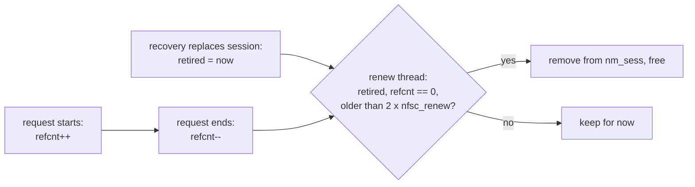

# Bug #3: every recovery leaks a session until unmount

Patch: [`session-leak.patch`](session-leak.patch), against main
a2fbd988638e. Not filed yet. Bugzilla text:
[`BUGREPORT-session-leak.txt`](BUGREPORT-session-leak.txt).

Read [`badsession.md`](badsession.md) first: it explains sessions and
recovery.

## 1. Background

**Where sessions live.** Each NFS mount keeps its sessions in a list,
`nm_sess` in `struct nfsmount`. The first entry is the live session. Each
entry is a `struct nfsclds` allocated with the malloc type `M_NFSCLDS`, which
`vmstat -m` shows as `NFSCL session`.

**Why recovery cannot free the old session.** When recovery opens a new
session, `nfsrpc_setclient()` (`sys/fs/nfsclient/nfs_clrpcops.c`) puts it at
the head of the list and marks the old one defunct. It cannot free the old
one yet, and the source says so: "The old sessions cannot be safely free'd
here, since they may still be used by in-progress RPCs." Another thread may
be in the middle of a request that points at it, or asleep waiting for one
of its slots, with the wait channel inside the session itself.

**Reference counting.** The usual answer in a kernel: each user of an object
increments a counter (`refcnt`) while it uses it and decrements it when done.
The object is freed only once the counter is 0 and nobody new can find it.

## 2. The problem

Nothing ever freed the old sessions. `nfscl_freenfsclds()` is called on them
only at unmount. On a server that forces frequent recoveries, a long-lived
mount grows its list, and its memory, without limit.

Measured on three mounts on EFS, over 2.5 days:

```
$ vmstat -m | grep NFSCL
    NFSCL session  256 262144  834 1024
$ nfsstat -c -E
   ExchangeId   CreateSess  DestroySess  DestroyClId
          374          834          114          114
```

`NFSCL session` in use went from 37 to 64 in 8 hours, then to 256 after 19
more, still with three mounts. That is about 1 KB per recovery, and the renew
thread walks the whole list every time it runs.

In the VM, without EFS, each reset adds one session: 4 resets take
`NFSCL session` from 1 to 5.

## 3. The fix

Count who uses a session, record when recovery replaced it, and free it
later:



- `nfscl_reqstart()` takes a reference on the session it hands to the
  request, and marks the request `ND_HOLDSESS`. A thread waiting for a slot
  therefore holds a reference too.
- `newnfs_request()` becomes a small wrapper that drops the reference on
  every way out. When the "Badsession looping" retry moves a request to the
  new session, the reference moves with it.
- `nfsrpc_setclient()` stamps `nfsess_retired` when recovery replaces a
  session.
- `nfscl_freeretiredsess()`, called from the renew thread, frees retired
  sessions that nobody holds and that were retired more than
  2 x `nfsc_renew` ago. It never frees the live session.

Why a flag and not just the session pointer: `nfsrv_getuser()` builds its
request on the stack without `nfscl_reqstart()`, so a pointer alone could be
garbage.

Alternatives, and why they are not enough:

- **Free on a timer.** A thread can sleep inside a session for a long time,
  and a timer cannot know that.
- **Free when no slot is busy.** `nfsv4_setsequence()` drops the mount lock
  before `nfsv4_sequencelookup()` takes the session lock, so a request can
  be about to use a session that looks idle. Slots are not a usage count
  either: when recovery replaces a session during a request, the reply's
  session ID no longer matches and the old slot is never freed.

Caveat: about 20 places read the live session without taking a reference,
to copy its client ID, session ID or reply cache size. Each read is
immediate, and the 2 x `nfsc_renew` grace period, not the counter, covers
them.

## 4. Tested

bhyve VM, local nfsd behind `efs-reset-proxy.py`, reset pairs 15 s apart
every 120 s, run together with the fix for bug #2:

| 420 s, 8 resets | stock | patched, GENERIC-NODEBUG | patched, GENERIC (INVARIANTS, WITNESS) |
|---|---|---|---|
| `NFSCL session` in use | 1 to 9 (one per reset) | at most 3 | at most 3 |
| lock order reversal, KASSERT, panic | - | - | none |

Untested: pNFS (data server sessions) and Kerberos mounts. The
`tests/sys/fs/nfs` framework does not check for this leak yet.
