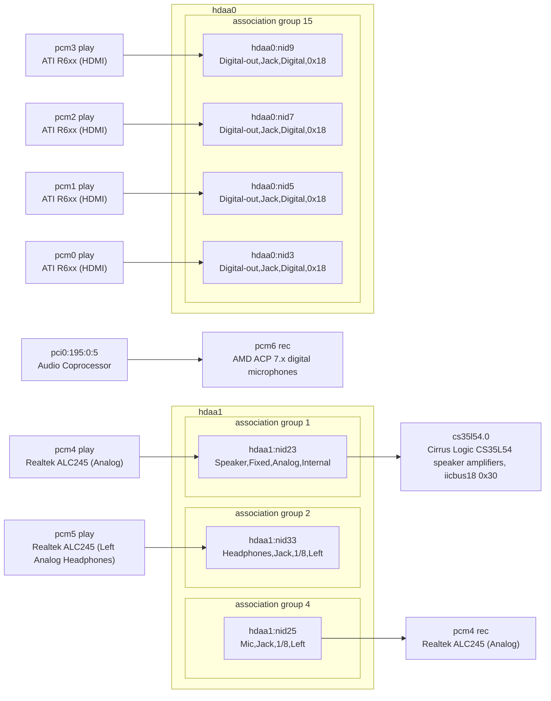

# hdaa2dot example: HP ZBook audio topology

Output of `hdaa2dot -m`, following the audio: playback pcm on the left, recording pcm on the right. Two HDA codecs (ATI HDMI, Realtek ALC245), the CS35L54 smart amplifiers behind the speaker pin, and the AMD ACP digital microphones attached directly to PCI.

