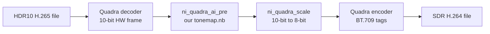
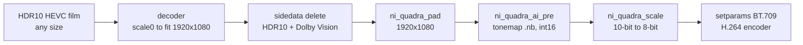

# NETINT Quadra: a custom AI filter for HDR to SDR tonemapping

Audience: first-year students. Goal: run our own neural network on the Quadra AI engine (NPU) to convert HDR10 video to SDR, inside an FFmpeg pipeline. The card ran on FreeBSD here (libxcoder port, see below); nothing in the AI part is FreeBSD-specific.

Read first: [netint_quadra.md](../../FreeBSD/docs/netint_quadra.md) (the card, libxcoder, the FreeBSD port). This document builds on its section 7.11 (AI engine).

Facts marked **(verified)** were measured on the machines or read from source. Facts marked **(to verify)** are the plan and must be checked before relying on them.

Machines are named by role. One machine can hold several roles; here there were three:
- `quadra-host`: has the Quadra card, decodes, runs the network on the NPU, encodes. Here: FreeBSD, card `QuadraT1U-EP3`, firmware `5906tFr1`, NETINT FFmpeg fork in `~/netint_ffmpeg`, libxcoder in `~/netint_libxcoder`, models and test files in `~/ai_test/`. Linux with the stock libxcoder works the same way.
- `toolkit-host`: x86 Linux with AVX and podman. Runs the NETINT AI Toolkit container: compiles models to `.nb`, and trains them. Here: Ubuntu 26.04, 32 threads (AVX2, AVX-512), 91 GB RAM.
- `gpu-host`: has a Vulkan GPU and the film library (`$FILMS`). Runs libplacebo for the training targets, and Jellyfin. Here: FreeBSD with an AMD iGPU.

## 1. Vocabulary

| Term | Meaning |
|---|---|
| HDR10 | High Dynamic Range video: 10-bit, BT.2020 colors, PQ transfer curve, up to 10 000 nits |
| SDR | Standard Dynamic Range: 8-bit, BT.709 colors, gamma curve, about 100 nits |
| PQ | Perceptual Quantizer (SMPTE ST 2084): maps code values to absolute brightness |
| Tonemapping | Squeezing HDR brightness and colors into the SDR range without clipping or washing out |
| NPU | Neural Processing Unit: the Quadra AI engine (Vivante VIP8000 NanoQi Plus, 18 TOPS) |
| Tensor | A multi-dimensional array: the input and output of a network |
| Quantization | Storing tensors and weights as small integers (uint8, int16) instead of floats, so the NPU can run them fast |
| NBG / `.nb` | Network Binary Graph: the compiled model file the card loads |
| ONNX | Open file format for neural networks; PyTorch exports it |
| Acuity / `pegasus.py` | VeriSilicon compiler inside the NETINT AI Toolkit: imports, quantizes and exports models to `.nb` |

## 2. Why use the NPU for tonemapping

**(verified)** The Quadra has no tonemap filter. The NETINT documentation (v5.9.0) lists none, and the only 10-bit to 8-bit option in the decoder (`force8Bit0=1`) shifts out the low 2 bits. That keeps the PQ curve, so the SDR picture looks grey and flat.

**(verified)** On `workstation`, the stock FFmpeg has `tonemap` (CPU) and `libplacebo` (Vulkan GPU), but no `zscale`. A CPU tonemap at 4K is slow, and it forces a download of every frame from the card to the host and back.

**(verified 2026-11-10) A GPU does it well, and one already does at home.** `gpu-host` (FreeBSD, AMD iGPU with `gc_11_0_1` firmware loaded by `amdgpu.ko`, `/dev/dri/renderD128`) runs Jellyfin with HDR tonemapping on. Its configuration (`/var/db/jellyfin/config/encoding.xml`) has `EnableTonemapping` true, `TonemappingAlgorithm` `bt2390` and `HardwareAccelerationType` `vaapi`, with `jellyfin-ffmpeg8` (8.1.2-Jellyfin). A transcode log shows the whole chain on the GPU:

```
-vf "setparams=color_primaries=bt2020:color_trc=smpte2084:colorspace=bt2020nc,
     hwmap=derive_device=drm,format=drm_prime,
     libplacebo=upscaler=none:downscaler=none:format=bgra:tonemapping=bt.2390:peak_detect=0:
                color_primaries=bt709:color_trc=bt709:colorspace=bt709,
     format=vulkan,hwmap=derive_device=vaapi,format=vaapi,scale_vaapi=format=nv12"
```

VAAPI decodes, libplacebo tonemaps on Vulkan (BT.2390 curve, no per-scene peak detection), and VAAPI encodes H.264. The system FFmpeg on `gpu-host` (9.0.1) also has `libplacebo` (libplacebo 7.372) and Vulkan. On one 4K frame, `ffmpeg -init_hw_device vulkan -i frame.hevc -vf libplacebo=w=960:h=-2:tonemapping=bt.2390:gamut_mode=perceptual:colorspace=bt709:color_primaries=bt709:color_trc=bt709:range=tv:format=yuv420p10le` takes 0.5 s, process start included.

So the NPU is not the only hardware that can tonemap. What the NPU route offers is keeping the frame on the Quadra: a Quadra transcoding server needs no GPU. libplacebo on `gpu-host` is also the better candidate for training targets (section 8.2): BT.2390 with real gamut mapping, instead of Hable with clipping.

A network on the NPU keeps the frame on the card: decode, tonemap, encode, all in hardware.



## 3. How a frame reaches the network

### 3.1 The generic filter: `ni_quadra_ai_pre`

**(verified, `~/netint_ffmpeg/libavfilter/vf_ai_pre_ni.c`)**
- It accepts `yuv420p`, `yuvj420p`, `yuv420p10le` and hardware frames (`query_formats()`, line 115).
- The output hardware frame keeps the input pixel format: `out_frames_ctx->sw_format = in_frames_ctx->sw_format` (line 749). A 10-bit HDR frame in gives a 10-bit frame out. Our network must therefore write SDR values into a 10-bit container, and a later filter converts to 8-bit.
- The network input resolution must match the frame resolution, else the filter fails at init. One `.nb` per resolution.
- `mode=1` makes the network process only Y and copies U and V. Tonemapping changes colors, so we need `mode=0`.

### 3.2 What the example models expect

We cannot read the tensor layout from the documentation. So we wrote a probe, [`nbinfo.c`](nbinfo.c): it opens an AI session, loads a `.nb` with `ni_ai_config_network_binary()` and prints every input and output tensor.

```sh
cc -Wall -o nbinfo nbinfo.c -I/usr/local/include -L/usr/local/lib -Wl,-rpath,/usr/local/lib -lxcoder
sudo ./nbinfo GentleAIEnhance_1280x720.nb
```

**(verified 2026-11-09, quadra-host)** Results for the models shipped with the NETINT package:

| Model | Inputs | Outputs | Type |
|---|---|---|---|
| `GentleAIEnhance_1280x720` | 1280x1080x1 | 1280x1080x1 | uint8, affine scale 1 zero 4 |
| `GentleAIEnhance_1440x1080` | 1536x1620x1 | 1536x1620x1 | uint8 |
| `GentleAIEnhance_720x1280` | 768x1920x1 | 768x1920x1 | uint8 |
| `hw_bicubic_network_binary` | Y 1920x1080, U 1024x540, V 1024x540 | Y 1280x720, U 640x360, V 640x360 | uint8 |
| `network_binary_yolov4_head` | 416x416x3 | 13x13x18, 26x26x18 | uint8 |
| `segm32_tflite_nchw_bgr` | 256x144x3 | 2x256x144 | uint8 |

What this teaches us:
- The image models see the **raw frame memory**, not RGB pixels. The tensor width is the line stride (the width rounded up to 128 bytes: 1440 gives 1536, 720 gives 768). The single-input models stack the three planes in one tensor: 1080 = 720 rows of Y plus 360 rows of U and V.
- `hw_bicubic` shows the other layout: **one input per plane** (Y, U, V). This is the layout we want, because tonemapping must mix luma and chroma, and separate planes make that easy to express.
- **Every example is uint8.** A 10-bit frame stores each sample in 16 bits (`yuv420p10le`). A uint8 tensor would see the low and high bytes as separate pixels. Our network needs **int16 inputs and outputs**.

**(verified 2026-11-10, section 5)** A 1920x1080 `yuv420p10le` frame maps to Y = 1920x1080 and U, V = 960x540 int16 tensors: 3840 and 1920 bytes per line, both already multiples of 128. The firmware feeds the 10-bit planes to int16 tensors unchanged.

## 4. The toolchain: NETINT AI Toolkit on toolkit-host

### 4.1 What it is

**(verified)** The toolkit is public: `https://releases.netint.com/quadra/AI-ToolKit/KJE563DFE34D/Quadra_AI_V4.5.tar.gz` (1 084 541 430 bytes), with three PDF guides next to it (Quick Start, User Guide, Python Inference API). Inside: Acuity 6.12.7 (`pegasus.py`), the Vivante IDE and simulator, `aiperf`, `NB_Info` (an offline `.nb` parser) and examples (lenet, mobilenet, resnet18, yolov4-tiny, deeplabv3).

**(verified, User Guide V4.5)**
- Model input: ONNX (operator sets 1 to 16, ONNX 1.8.0), TFLite (TF 2.8 schema), PyTorch 1.5.1, Keras, Caffe, Darknet.
- Quantization: uint8 asymmetric affine, int8 per-channel, **int16 dynamic fixed point**, bfloat16.
- Host: Ubuntu 20.04 with Python 3.8, x86 CPU with AVX. Other Ubuntu versions are "not recommended". It does not run on FreeBSD.
- Compile target for Quadra: `VIP8000NANOQI_PLUS_PID0XB1`.

### 4.2 Container setup

toolkit-host runs Ubuntu 26.04 with Python 3.14, too new for the toolkit wheels (TensorFlow 2.3.0, torch 1.5.1). We run Ubuntu 20.04 in a rootless podman container instead.

**(verified 2026-11-09)** `podman` 5.7.0 installed with apt. The toolkit was downloaded and unpacked to `toolkit-host:~/netint_ai/tk/NETINT_toolkit`, and the `ubuntu:20.04` image starts.

The image is built from [`Containerfile`](Containerfile) (copied to `toolkit-host:~/netint_ai/ctx/`). The environment variables replace `tools/setup_bashrc.py`, which would edit `~/.bashrc`:

```dockerfile
FROM docker.io/library/ubuntu:20.04
ENV DEBIAN_FRONTEND=noninteractive
RUN apt-get update && apt-get install -y --no-install-recommends \
	python3 python3-pip python3-dev build-essential libgl1 libglib2.0-0 \
	libsm6 libxext6 libxrender1 git ca-certificates && rm -rf /var/lib/apt/lists/*
COPY requirements.txt acuity_bin_cpu-6.12.7-cp38-cp38-manylinux2010_x86_64.whl /tmp/
RUN python3 -m pip install --upgrade pip==21.0.1 && \
	pip3 install --no-cache-dir -r /tmp/requirements.txt && \
	pip3 install --no-cache-dir /tmp/acuity_bin_cpu-6.12.7-cp38-cp38-manylinux2010_x86_64.whl
ENV TF_CPP_MIN_LOG_LEVEL=3 PIP_DISABLE_PIP_VERSION_CHECK=1 \
	ACUITY_PATH=/root/NETINT_toolkit/toolkit-whl-6.12.7/bin \
	VIVANTE_BASE=/root/NETINT_toolkit/VivanteIDE5.7.2 \
	VIVANTE_VIP_HOME=/root/NETINT_toolkit/VivanteIDE5.7.2 \
	VIVANTE_SDK_DIR=/root/NETINT_toolkit/VivanteIDE5.7.2/cmdtools/vsimulator \
	NETINT_TOOLS=/root/NETINT_toolkit/tools \
	LMX_LICENSE_PATH=/root/NETINT_toolkit/VivanteIDE5.7.2/license/Netint_VIP8000NanoQiPlus_License_20211021.lic \
	VSIMULATOR_CONFIG=VIP8000NANOQI_PLUS_PID0XB1 \
	LD_LIBRARY_PATH=/root/NETINT_toolkit/VivanteIDE5.7.2/cmdtools/vsimulator/lib \
	USE_IDE_LIB=1 NBINFO=/root/NETINT_toolkit/NB_Info_v1.2.10
ENV PATH=$PATH:$ACUITY_PATH:$ACUITY_PATH/tools:$VIVANTE_VIP_HOME/cmdtools/common/bin:$NETINT_TOOLS:$VIVANTE_BASE:$VIVANTE_BASE/ide:$NBINFO
WORKDIR /root/NETINT_toolkit
```

Build and enter it (the toolkit tree and a work directory are bind-mounted, so results stay on toolkit-host):

```sh
cd ~/netint_ai
cp tk/NETINT_toolkit/requirements.txt tk/NETINT_toolkit/installation_packages/acuity_bin_cpu-*.whl ctx/
podman build -t netint-ai:4.5 ctx
mkdir -p work
podman run --rm -it -v ~/netint_ai/tk/NETINT_toolkit:/root/NETINT_toolkit:Z \
	-v ~/netint_ai/work:/work:Z netint-ai:4.5 bash
```

**(verified 2026-11-10)** The image builds (`localhost/netint-ai:4.5`), the container runs Python 3.8.10, and `tools/envcheck.py` ends with `Env check SUCCESS!!!`. On a copy of `examples/lenet_tf` in `/work`, `./convert.sh -c`, `-q` and `-e` all return 0 and produce `ovx_network_nbg_unify/network_binary.nb` (414 016 bytes). Export prints one warning twice: `Unsupported ovxlib version 1.1.30, should between 1.1.34 and 1.1.53`. The card loads that file anyway: `nbinfo` on `quadra-host` shows input `1x28x28x1` uint8 and output `10x1` fp16. So models built on toolkit-host load on the FreeBSD card. Work on a copy of each example, because `convert.sh` writes its outputs into the current directory.

### 4.3 The compile steps

**(verified, User Guide V4.5 and `examples/mobilenetv2_onnx/convert.sh`)** Every model goes through the same `pegasus.py` steps. Each example wraps them in a `convert.sh`:

| Step | Command | Output |
|---|---|---|
| Import | `pegasus.py import onnx --model m.onnx --inputs ... --outputs ... --input-size-list ... --input-dtype-list ...` | `m.json`, `m.data` |
| Input metadata | `generate_inputmeta.py --model m.json ...` | `m_inputmeta.yml` (input scaling) |
| Quantize | `pegasus.py quantize ... --quantizer dynamic_fixed_point --qtype int16` | `m.quantize` |
| Check | `pegasus.py inference ... --dtype quantized` | tensors in `raw_data_i/` to compare with float |
| Export NBG | `pegasus.py export ovxlib ... --pack-nbg-unify --optimize VIP8000NANOQI_PLUS_PID0XB1 --viv-sdk $VIVANTE_SDK_DIR --dtype quantized` | `.nb` in `ovx_network/` |

`--input-dtype-list` accepts `float`, `int8`, `uint8`, `int16` and `uint16`.

## 5. Step 1: the pipe test (identity network)

Before training anything, prove that a 10-bit frame goes into an int16 network and comes out unchanged. If this fails, `ni_quadra_ai_pre` cannot carry HDR data, and we stop here (or write a custom C filter that feeds the tensors itself).

**Result (verified 2026-11-10): the pipe works.** 10-bit frames go through an int16 network bit-exact.

Scripts: [`pipe_test/`](pipe_test/).
- `make_pipe_onnx.py identity|invert W H DIR` writes the ONNX model with the `onnx` helper API, plus random 10-bit calibration tensors (`.npy`) and `dataset.txt`.
- `convert.sh identity|invert W H` runs inside the container and compiles it to `pipe_<mode>_<W>x<H>_int16.nb`.
- `check_invert.py ref.yuv inv.yuv W H` compares two raw frame dumps sample by sample.

### 5.1 The two networks

Both have 3 inputs and 3 outputs, one per plane, each of shape `[1, H, W, 1]`. That shape has the same memory order as a frame plane. After compiling, `nbinfo` shows `1x1920x1080x1`, exactly the layout of NETINT's `hw_bicubic` model. `ni_quadra_ai_pre` reads the frame width from `sizes[1]` and checks it against the frame (line 611), so this layout passes.
- **identity**: `Relu` on each plane. Samples are never negative, so `Relu` changes nothing, but it is a real layer that the compiler cannot remove.
- **invert**: `Y' = 1023 - Y` (`Sub` with a constant), with `Relu` on U and V.

```sh
# toolkit-host, in ~/netint_ai/work/pipe_test
podman run --rm -v ~/netint_ai/tk/NETINT_toolkit:/root/NETINT_toolkit:Z \
	-v ~/netint_ai/work:/work:Z -w /work/pipe_test netint-ai:4.5 \
	./convert.sh identity 1920 1080
```

`nbinfo` on the card, for both files: 3 inputs and 3 outputs, every tensor `format=int16 quant=dfp fixed_point_pos=0` (Y `1x1920x1080x1`, U and V `1x960x540x1`).

### 5.2 Toolkit traps found on the way

Each of these cost one failed run:
- `pegasus.py import onnx --size-with-batch 'False,False,False'` fails with `The length of inputs and size-with-batch must be equal.`, although the User Guide documents that syntax. Leave the option out: the default is `False` for every input.
- The `NPY` dataset type fails with `NPY provider only supports 1 port.` For several inputs, use the `TEXT` type: one line per sample, one `.npy` file per input, separated by spaces. Also set `category: undefined`, because the data are not images.
- `pegasus.py quantize` reuses an existing `.quantize` file instead of overwriting it. Delete the file before each run (NETINT's examples also do `rm ${NAME}.quantize`).
- The quantizer skipped the Y input of the invert network, because that input feeds `Sub` with a constant. A tensor with no entry in `.quantize` is exported as **fp16**: `nbinfo` showed Y as `format=fp16 quant=none`. `convert.sh` finds the tensors that the quantize log lists as `float32` and adds int16 entries for them under `quantize_parameters:`. **Always check every tensor with `nbinfo` after a compile.**
- Dynamic fixed point picks the fraction bits (`fl`) from the calibration range: 0 to 1023 gives `fl: 5`, so the network would read sample 320 as 10.0. Our samples are integers, so `convert.sh` sets `fl: 0` on every tensor. For the tonemap network, choose the `fl` of the inputs and outputs the same way, and let the quantizer choose the internal ones.

### 5.3 The test on the card

Test clip, made with the Quadra encoder: 60 frames of `testsrc2`, 1920x1080, H.265 Main 10, `yuv420p10le`:

```sh
ffmpeg -f lavfi -i testsrc2=size=1920x1080:rate=30 -frames:v 60 -pix_fmt yuv420p10le \
	-c:v h265_ni_quadra_enc -xcoder-params "profile=2" t10.hevc
```

Identity network against the plain hardware decode, frame hashes:

```sh
D="-c:v h265_ni_quadra_dec -dec 0 -xcoder-params out=hw -i t10.hevc"
sudo ffmpeg $D -vf hwdownload,format=yuv420p10le -f framemd5 ref.md5
sudo ffmpeg $D -vf ni_quadra_ai_pre=nb=pipe_identity_1920x1080_int16.nb,hwdownload,format=yuv420p10le \
	-f framemd5 identity.md5
```

Result: 60 of 60 frame hashes identical.

Identical hashes alone could also mean the filter skipped the NPU. The invert network rules that out. Dump 5 raw frames with and without it (`-frames:v 5 -f rawvideo`), then compare:

```
$ python3 check_invert.py ref.yuv inv.yuv 1920 1080
frame 0: Y mismatches 0/2073600, UV mismatches 0/1036800, Y[0] 317->706
frame 1: Y mismatches 0/2073600, UV mismatches 0/1036800, Y[0] 326->697
...
frame 4: Y mismatches 0/2073600, UV mismatches 0/1036800, Y[0] 332->691
```

Every Y sample is exactly `1023 - Y`, and U and V are untouched. So the NPU really computed on the 10-bit values, and the int16 output reached the next filter.

**Not measured yet:** speed. The clip is too short, and decode alone runs at about 430 fps.

## 6. Step 2: the reference SDR output

A network learns from examples: pairs of (HDR frame, correct SDR frame). We make the SDR frames with a trusted software tonemapper.

**Result (verified 2026-11-10):** 880 pairs from 22 films, 2.3 GB, on `toolkit-host:~/netint_ai/work/tonemap/tm_pairs/`.

Scripts: [`tonemap/`](tonemap/).

### 6.1 The tonemapper: zscale + tonemap in the NETINT fork

**(verified)** The NETINT FFmpeg fork on `quadra-host` had `tonemap` but not `zscale`. `tonemap` expects linear light (float RGB), and `zscale` is the filter that converts PQ to linear. So we rebuilt the fork with two more libraries:

```sh
sudo pkg install -y sekrit-twc-zimg dav1d
cd ~/netint_ffmpeg
./configure --enable-gpl --enable-ni_quadra --disable-ni_logan --enable-pthreads \
	--disable-doc --disable-ffplay --cc='ccache cc' \
	--extra-cflags=-I/usr/local/include --extra-ldflags=-L/usr/local/lib \
	--enable-libzimg --enable-libdav1d
gmake -j4
```

Trap: the FreeBSD package called `zimg` (5.0.0) is a different project. It installs only `zimg.h`, so configure fails with `zimg >= 2.7.0 not found using pkg-config`. The library `zscale` needs is the package `sekrit-twc-zimg` (3.0.6). `libdav1d` adds a software AV1 decoder. It was not needed in the end, because all the chosen films are HEVC.

The tonemap chain, in `make_reference.sh`:

```
zscale=w=960:h=-2:f=spline36:tin=smpte2084:min=bt2020nc:pin=bt2020:rin=tv,format=yuv420p10le,split[h][s];
[s]zscale=t=linear:npl=100,format=gbrpf32le,zscale=p=bt709,
   tonemap=tonemap=hable:peak=10:desat=0,zscale=t=bt709:m=bt709:r=tv,format=yuv420p10le[d]
```

- First the frame is scaled down **in the PQ domain**. The `[h]` output is the HDR input of the pair: exactly the kind of frame the NPU will receive. The SDR target `[d]` is made from that same small frame, so the two match pixel for pixel.
- Width 960: the network works per pixel, so a smaller frame teaches it the same thing at a quarter of the disk space.
- `peak=10` fixes the curve at 1000 nits (10 x `npl` 100) for every film. Without it, `tonemap` reads the peak from each file's metadata, and the network would get different targets for the same input.
- `tin/min/pin/rin` pin the input colorspace to HDR10. On a test frame the output was byte-identical with and without them (same md5): the decoder already tagged the frames correctly. They protect against files with missing tags.

### 6.2 The source films: the Jellyfin database

The films are on `gpu-host` under `$FILMS` (the film library root), indexed by Jellyfin. Jellyfin stores its library in SQLite (`/var/db/jellyfin/data/jellyfin.db`). The database is in WAL mode, so a read-only open fails with `attempt to write a readonly database`. Open it with `?immutable=1` instead:

```sh
sqlite3 "file:/var/db/jellyfin/data/jellyfin.db?immutable=1" "
SELECT m.Codec, m.ColorTransfer, IFNULL(m.DvProfile,'-'), COUNT(*)
FROM MediaStreamInfos m JOIN BaseItems b ON b.Id = m.ItemId
WHERE m.StreamType = 1 AND m.ColorTransfer IN ('smpte2084','arib-std-b67')
  AND b.Path LIKE '$FILMS/%' GROUP BY 1,2,3;"   # put the real path in place of $FILMS
```

**(verified 2026-11-10)** 971 HEVC PQ films: 587 are Dolby Vision profile 8, and 14 carry HDR10+. Also 1 AV1 PQ film and no HLG. Dolby Vision profile 8 has an HDR10-compatible base layer: the decoder ignores the Dolby Vision data and outputs plain HDR10.

The database has no mastering peak. We picked films across genres from the database (`BaseItems.Genres`), then read the peak of each one with `ffprobe -show_entries stream_side_data=max_luminance,max_content`. We kept 22 films mastered at 1000 nits ([`films.txt`](tonemap/films.txt)) and dropped three mastered at 4000 nits: the fixed 1000-nit curve would clip their highlights and contradict the other films.

### 6.3 Cutting frames without copying films

`quadra-host` cannot see `$FILMS`, and seeking in a 20 GB film over ssh is not practical. So `cut_keyframes.sh` runs on `gpu-host`. It extracts 40 single keyframes per film, spread from minute 5 to 10 minutes before the end (no logos, no credits), with stream copy. That means no decode: each frame is a 0.1 to 0.2 MB `.hevc` file. The 880 frames make about 90 MB, sent to `quadra-host` with `tar` over ssh, where `make_reference.sh` makes the pairs (about 0.4 s per frame).

On `gpu-host`, for each film of the list (paths relative to `$FILMS`):

```sh
grep -v '^#' films.txt | while IFS='|' read -r tag f; do
	sh cut_keyframes.sh "$FILMS/$f" "$tag" 40 frames </dev/null || echo "FAIL $tag"
done
```

Trap: in `ssh host 'tar -xf - && ... & echo started'`, the `&` sends the whole `&&` chain to the background. A background command in a non-interactive shell reads stdin from `/dev/null`, so `tar` unpacked nothing. Run the `tar` alone, then start the background job in a second command.

### 6.4 What the pairs look like

Each pair is two raw `yuv420p10le` files, `hdr_<film>_<n>.yuv` and `sdr_<film>_<n>.yuv`, 960 pixels wide. The height depends on the film's aspect ratio and follows from the file size: `height = size / (960 x 1.5 x 2)`. Sizes found: 400, 402, 408, 518, 520 and 540 rows.

Visual check on two pairs (converted to PNG):
- Daylight scene (The Incredible Hulk): the SDR target has normal contrast and saturation. The HDR frame shown without conversion looks flat and grey, as expected for PQ.
- Dim, red-lit interior (Star Trek IV): the SDR target is very red and dark. I first took that for a Hable defect. It is not: libplacebo (BT.2390, perceptual gamut mapping, on `gpu-host`) renders the same frame just as red. The scene is lit red. The mistake came from the "naive" PNG, which shows PQ samples as if they were BT.709 and so washes the colors out. Lesson: judge a tonemap against a second, independent tonemapper, not against the raw HDR samples.

zscale + Hable does clip saturated colors outside BT.709. That shows on Sol Levante (section 8.1), not on this frame. Changing the reference later means re-running only `make_reference.sh`.

Copyright: these frames come from commercial films. They are fine for training, but do not publish them. For images in a public document, use an openly licensed HDR10 clip.

### 6.5 Second target set: libplacebo on gpu-host (verified 2026-11-10)

Script: [`make_reference_placebo.sh`](tonemap/make_reference_placebo.sh), run on `gpu-host` (section 2). It keeps the HDR half of every pair (`hdr_*.yuv`, the samples the NPU sees) and makes a new SDR half with libplacebo: BT.2390 curve, perceptual gamut mapping, the same family of settings Jellyfin uses. The new set, `pl_pairs/` on toolkit-host, links the same HDR files and holds the new SDR files (744 MB).

```
libplacebo=tonemapping=bt.2390:gamut_mode=perceptual:peak_detect=0:dithering=none:
           colorspace=bt709:color_primaries=bt709:color_trc=bt709:range=tv:format=yuv420p10le
```

Two settings matter for training targets, both measured on one frame:
- `dithering=none`. With it, two runs give the same md5, so the targets are deterministic. libplacebo dithers by default, which adds noise the network cannot learn.
- **The source peak.** libplacebo reads it from the frame's HDR metadata, and raw `.yuv` frames carry none. The same frame without metadata, and tagged 1000, 4000 or 10 000 nits, gives four different md5s. The no-metadata default matches none of the three. So each frame first goes through lossless x265, tagged as mastered on a 1000-nit P3 D65 display, which is how the training films were mastered. Decoding that file gives back the exact `.yuv` bytes (checked with `cmp`). This fixes the curve at 1000 nits for every pair, as `peak=10` did for Hable.

Speed: about 1 s per frame including the two ffmpeg starts; 880 frames took a few minutes with 4 jobs in parallel (`xargs -P 4`).

Validation PSNR of the HDR samples left unchanged, against each target: 26.81 / 39.03 / 32.68 dB (Y/U/V) for Hable, 23.77 / 36.23 / 30.95 for libplacebo. So the libplacebo targets are further from the input: with these settings, libplacebo changes the samples more than zscale + Hable does.

## 7. Step 3: the model

Tonemapping is mostly a per-pixel function: each output pixel depends on the same input pixel (its Y, U and V), not on its neighbours. A 1x1 convolution applies the same small calculation to every pixel, so a stack of 1x1 convolutions is a learned per-pixel function. That is cheap on the NPU.

The only difficulty is 4:2:0: U and V have half the resolution of Y.

The first plan (not built) had a luma branch that upsampled U and V and a chroma branch that average-pooled Y. Section 7.1 describes what was built instead; section 8.2 describes the faster graph used on the card. Rules that stayed:
- Input and output scale: 10-bit code values (0 to 1023) as int16.
- Keep the plane tensors at `[1, H, W, 1]`, the layout proven in section 5. ONNX convolutions want `[N, C, H, W]`, so reshape each plane to `[1, 1, H, W]` first. A reshape does not move data. Reshape the results back to `[1, H, W, 1]` before the outputs.
- Loss: mean squared error against the reference SDR planes; check PSNR per plane.

This gives a **static** tonemap: one curve for every video. HDR10 static metadata (MaxCLL, mastering display) and HDR10+ dynamic metadata are ignored. A video mastered at 1000 nits and one at 4000 nits get the same curve. Adapting to the metadata would need a custom C filter that passes the metadata to the network as an extra input.

Before quantizing, check the float model on the CPU against the reference. Then quantize to int16 and check again: the gap between float and int16 shows the quantization loss. uint8 would cause visible banding in dark gradients, which is why we use int16.

### 7.1 What was built (verified 2026-11-10)

Scripts: [`train_tonemap.py`](tonemap/train_tonemap.py), [`make_calib.py`](tonemap/make_calib.py), [`convert_tonemap.sh`](tonemap/convert_tonemap.sh).

The network changed from the proposal above. It needs no upsample and no average-pool, because every layer runs at chroma resolution:

```
h  = relu(conv 2x2 stride 2 (Y) + conv 1x1 (U) + conv 1x1 (V))   # one 2x2 luma block + its chroma
h  = relu(conv 1x1 (h))                                          # DEPTH times
Y' = conv-transpose 2x2 stride 2 (h),  U' = conv 1x1 (h),  V' = conv 1x1 (h)
```

The 2x2 stride-2 convolution reads the four luma samples that share one chroma sample, and the transposed convolution writes four luma samples back. So the graph is only convolutions, ReLU and Add, which the NPU supports. The `/1023` input scaling and the `*1023` output scaling are folded into the first and last layers before export: the ONNX model takes and returns 10-bit code values.

Training runs in the toolkit container on toolkit-host (PyTorch 1.5.1, CPU only; section 9 explains why no GPU):

```sh
podman run --rm -v ~/netint_ai/tk/NETINT_toolkit:/root/NETINT_toolkit:Z \
	-v ~/netint_ai/work:/work:Z -w /work/tonemap netint-ai:4.5 \
	python3 train_tonemap.py tm_pairs run_w32d2 --iters 20000 --width 32 --depth 2
# the chosen model (section 8.1, test 5): libplacebo targets, fused export
	python3 train_tonemap.py pl_pairs runpl3_w48d2 --iters 30000 --width 48 --depth 2 --export-fused
```

Trap: `podman run ... > log 2>&1 < /dev/null > /dev/null 2>&1 &` sends the output to `/dev/null`, because the last redirection wins. One run lost its log this way; its validation numbers were recomputed from the saved `tonemap.pt` with `T.evaluate()`.

The training loop draws random 64x64 crops (at chroma resolution) from 800 pairs and uses Adam with a cosine learning rate. Two films (The Revenant, Toy Story 3: 80 pairs) are held out for validation. One run of 20 000 iterations took about 15 minutes alone on 32 threads.

Validation PSNR (10-bit, full frames, against the zscale + Hable target):

| Model | Y | U | V |
|---|---|---|---|
| no tonemap (HDR samples unchanged) | 26.81 | 39.03 | 32.68 |
| width 32, depth 2, 200 iterations | 31.21 | 30.37 | 27.93 |
| width 32, depth 2, 20 000 iterations | **45.41** | **50.15** | **47.72** |
| width 16, depth 1, 20 000 iterations | 36.77 | 43.81 | 42.20 |
| width 8, depth 1, 20 000 iterations | 36.33 | 39.43 | 37.40 |

The narrow models stop improving near 36 to 37 dB Y after about 5 000 iterations. Training longer does not close the gap: they lack capacity, not training time.

### 7.2 Compiling: fraction bits along the input and output paths

Calibration uses 16 HDR frames from the pairs, repeated 2x2 to the 1920x1080 network size (`make_calib.py`).

Trap: the first compiled model gave Y values about 10 times too small on the card (Y ≈ 15 where the reference has 142, PSNR 13 dB). Acuity inserts `permute` layers next to the `Reshape` layers of the plane layout (`*_acuity_mark_perm_*` in the `.json`). Reshape and permute do not convert between fixed-point formats, but the quantizer gave each of them its own `fl`. So the 10-bit integers were read with the wrong scale.

`convert_tonemap.sh` now walks the graph in `<name>.json`: from each input forward, and from each output backward, through reshape and permute layers. Every tensor on those paths gets `fl: 0`, including the output of the last convolution. The internal tensors keep the fraction bits the quantizer chose. Check after each compile: `nbinfo` must show `fixed_point_pos=0` on all inputs and outputs.

## 8. Step 4: run it and measure

Sections 8.1 to 8.3 measure the network alone (decode, network, raw output). Section 8.4 is the whole HDR10-to-SDR encode.

### 8.1 Results on the card (verified 2026-11-10)

Script: [`eval_clip.sh`](tonemap/eval_clip.sh). It decodes on the card and writes three raw streams: the software reference (zscale + Hable), the NPU output, and the HDR samples unchanged. It then prints PSNR against the reference, and against a colorist's SDR grade when one is given (`GRADED=`). `START_FRAME` and `FRAMES` select a segment with a `trim` filter, because an input `-ss` breaks the card decoder's hardware frames (`Setting BufferSourceContext.pix_fmt to a HW format requires hw_frames_ctx to be non-NULL!`).

**Test 1: Event Horizon** (a film not used for training). 240 frames, scaled in PQ to 1920x816, letterboxed to 1920x1080, encoded on the card as HEVC Main 10. PSNR is measured on the picture area only (`crop=1920:816:0:132`):

| vs zscale + Hable | Y | U | V |
|---|---|---|---|
| NPU, width 32 depth 2, int16 | 48.45 | 53.30 | 53.35 |
| no tonemap | 27.89 | 42.59 | 49.59 |

The quantized network on the card copies the software tonemap closely on live-action footage.

**Test 2: Sol Levante** (Netflix Open Content, anime). Both Netflix masters were converted to 1080p HEVC Main 10 at CRF 10 with `make_sollevante.sh`: the HDR10 grade (ProRes XQ, PQ, BT.2020) and the SDR grade (ProRes HQ, BT.709). The two grades have the same 6314 frames, and they are frame-aligned: luma SSIM is 0.957 at offset 0 and 0.907 at offset ±1. Segment: 600 frames from frame 2880.

| | Y | U | V |
|---|---|---|---|
| NPU vs zscale + Hable | 26.79 | 33.92 | 29.29 |
| no tonemap vs zscale + Hable | 23.37 | 26.12 | 19.09 |
| NPU vs colorist SDR grade | 23.79 | 29.22 | 27.14 |
| zscale + Hable vs colorist SDR grade | 20.99 | 28.13 | 25.41 |
| no tonemap vs colorist SDR grade | 24.40 | 23.69 | 23.53 |

367 of the 600 frames are under 30 dB Y against the reference, and the worst one is at 15 dB. Looking at that frame (a saturated red and orange explosion) explains it. The **reference** is the broken one: zscale clips the colors outside BT.709 into flat red areas and loses the detail. The network never saw such colors in the 22 live-action films, does not copy that clipping, and stays smooth. The colorist's grade is brighter and more yellow than both. On this title the network is closer to the colorist (23.8 dB Y) than the reference it was trained on (21.0 dB Y). But all three are far from the human grade: a fixed Hable curve is not what a colorist does.

**Speed** (1080p, decode on the card, network, no download; decode alone is 216 fps, the identity network 155 fps). The weights do not affect speed, so these were measured with untrained models:

| Network | fps |
|---|---|
| width 8, depth 0 | 69 |
| width 16, depth 0 | 38 |
| width 16, depth 1 | 27 |
| width 32, depth 0 | 19 |
| width 32, depth 1 | 15 |
| width 32, depth 2 (the trained model) | 10 (8.5 on Sol Levante) |
| width 64, depth 0 | 6.6 |
| width 32, depth 0, **uint8** (wrong values, speed only) | 41 |

The time grows linearly with the width, so it follows the size of the intermediate tensors (32 channels x 518 400 chroma sites x 2 bytes = 33 MB each per 1080p frame), not the arithmetic. The width-32 network uses about 13 GMAC/s, far below the NPU's 18 TOPS rating. uint8 is 2.2 times faster than int16 but changes nothing about the scaling.

**Test 3: the libplacebo-trained network** (section 6.5 targets, width 32 depth 2, trained with the first graph, exported fused, int16). Validation on the held-out films: 45.09 / 48.58 / 46.43 dB. On the card, with libplacebo references made on `gpu-host` from the exact HDR samples the card decodes (`REF=` in `eval_clip.sh`):

| | Y | U | V |
|---|---|---|---|
| Event Horizon: NPU vs libplacebo | 48.41 | 53.60 | 52.33 |
| Event Horizon: no tonemap vs libplacebo | 25.32 | 40.58 | 47.71 |
| Sol Levante: NPU vs libplacebo | 28.22 | 32.63 | 28.02 |
| Sol Levante: no tonemap vs libplacebo | 22.91 | 24.37 | 19.19 |
| Sol Levante: **NPU vs colorist grade** | **28.17** | **32.40** | 24.69 |
| Sol Levante: libplacebo vs colorist grade | 27.72 | 30.22 | 25.70 |
| Sol Levante: zscale + Hable vs colorist grade | 20.99 | 28.13 | 25.41 |

- libplacebo is a much better target than Hable: 6.7 dB closer to the colorist in Y.
- On live action, the network copies libplacebo as closely as it copied Hable (48.4 dB Y).
- On Sol Levante, the network is as close to the colorist as libplacebo itself (better in Y and U, worse in V). But it still differs from libplacebo by 28 dB Y.

**Test 4: more animation, then synthetic colors** (verified 2026-11-10). Same width 32 depth 2 network, libplacebo targets, int16 fused on the card:

| Training set | Validation Y/U/V | Event Horizon vs libplacebo (Y/U/V) | Sol Levante vs libplacebo (Y/U/V) | Sol Levante worst frame Y |
|---|---|---|---|---|
| 22 films (800 pairs) | 45.09 / 48.58 / 46.43 | 48.41 / 53.60 / 52.33 | 28.22 / 32.63 / 28.02 | 16.2 |
| + 17 animation films (1480) | 45.15 / 48.54 / 46.17 | 47.29 / 53.91 / 50.49 | 28.38 / 33.77 / 28.14 | 16.4 |
| + 300 synthetic frames (1780) | 42.96 / 48.03 / 46.66 | 45.38 / 49.83 / 49.60 | **37.53 / 39.50 / 40.06** | **32.2** |

The 17 animation films ([`films_anim.txt`](tonemap/films_anim.txt): Akira, Your Name, Spider-Verse, Encanto and others, all mastered at 1000 nits, 40 frames each) changed almost nothing. Two checks found why:
1. **Not quantization.** The float PyTorch model and the int16 NPU agree within 52 to 74 dB Y on the 15 worst Sol frames, and both miss libplacebo by the same amount.
2. **Not libplacebo's spatial step.** libplacebo's `contrast_recovery` (default 0.3) works on neighbouring pixels, which a per-pixel network cannot copy. But with and without it, libplacebo's output on those frames differs by only 63.7 dB Y.
3. **Out-of-range colors.** On the worst frame (Sol frame 56, an explosion), the median chroma distance from neutral is 168 code values. Over all 1560 training frames, the 99th-percentile distance is 56 on a typical frame and at most 188. Only 6 frames have a 99th percentile above 168. In those colors the network extrapolates and makes Y too bright by 153 code values on average. Even anime rarely reaches that saturation.

A per-pixel tonemap is in effect a lookup table, so the training data must cover the color space, not only the colors that films happen to use. [`make_synthetic.py`](tonemap/make_synthetic.py) writes 960x544 frames of flat 32x32 blocks. The block colors are drawn uniformly in R'G'B' (BT.2020, PQ, up to code value 0.80, about 1500 nits) and converted to limited-range 10-bit Y'CbCr. Flat 2x2 luma blocks keep 4:2:0 chroma consistent. libplacebo makes their targets on `gpu-host` like the real frames. With 300 synthetic frames (17% of the pairs), Sol Levante jumps by 9 dB Y and the worst frame from 16 to 32 dB. The cost is 2 to 3 dB on live action: the same 32-wide network now spreads its capacity over the whole color space.

**Test 5: wider networks** (verified 2026-11-10). Same 1780 pairs (films, animation, synthetic), depth 2, 30 000 iterations instead of 20 000, int16 fused on the card. Speed is decode plus network, no download:

| Width | Validation Y/U/V | Event Horizon vs libplacebo (Y/U/V) | Sol Levante vs libplacebo (Y/U/V) | Sol worst frame Y | Sol vs colorist Y | fps at 1080p |
|---|---|---|---|---|---|---|
| 32 (20 000 it.) | 42.96 / 48.03 / 46.66 | 45.38 / 49.83 / 49.60 | 37.53 / 39.50 / 40.06 | 32.2 | 27.86 | 37 |
| **48** | 47.81 / 48.87 / 48.41 | **49.80** / 51.13 / 50.84 | **41.71** / 42.22 / 42.07 | 33.8 | 27.73 | **27** |
| 64 | 48.99 / 50.83 / 50.15 | 49.55 / 52.22 / 54.86 | 43.05 / 42.70 / 42.57 | 36.9 | 27.83 | 21 |

- Width 48 wins back the live-action loss and more: 49.8 dB Y on Event Horizon, better than the first 22-film model (48.4), while keeping the gain on saturated colors (41.7 dB Y on Sol Levante). The longer training also helps; the two effects were not measured apart.
- Width 64 is better again on Sol Levante (43.0 dB Y), but at 21 fps it no longer keeps up with 24 fps film.
- Against the colorist's grade, all three stay at about 27.8 dB Y, like libplacebo itself (27.7). The network now copies libplacebo well enough that the target, not the network, sets the distance to a human grade.

**Chosen model: width 48, depth 2, int16, fused graph.** 27 fps at 1080p on the card.

### 8.2 Speed: the fused graph (verified 2026-11-10)

The time per frame follows the number of full-size intermediate tensors. The graph of section 7.1 makes many: the three input convolutions each write a 32-channel tensor, two Adds read and write them again, and three output convolutions read the last one three times.

The fused graph (`train_tonemap.py`, class `TonemapFused`) computes the same function with fewer of them:
- Input: a fixed 2x2 stride-2 convolution rearranges Y into 4 channels at chroma resolution (space-to-depth). `Concat` with U and V gives one 6-channel tensor, and one 1x1 convolution makes the 32-channel layer.
- Output: one 1x1 convolution makes 6 channels. A fixed 2x2 stride-2 transposed convolution puts channels 0 to 3 back as 2x2 luma blocks (depth-to-space). `Slice` takes U and V.

Both graphs compute exactly the same family of functions. A 2x2 convolution on Y plus 1x1 convolutions on U and V is the same linear map as one 1x1 convolution on the 6 stacked samples. But trained directly, the fused graph learned more slowly (37.9 dB Y at 14 000 iterations, against 44.7 for the first graph). So we train the first graph, and `--export-fused` converts the weights exactly (`to_fused()`; maximum difference 6e-7 on a test frame) before the ONNX export:

```sh
python3 train_tonemap.py pl_pairs run --iters 20000 --width 32 --depth 2 --export-fused
python3 train_tonemap.py tm_pairs out --iters 0 --load run_w32d2/tonemap.pt --export-fused   # convert a trained model
```

The `fl: 0` path walk in `convert_tonemap.sh` now also crosses `concat`, `slice`, the fixed space-to-depth convolution (stride 2, 4 output channels) and the depth-to-space deconvolution. These layers move integer samples, and `concat` and `slice` do not convert between formats. Without that, the last convolution wrote with `fl: 7` and the U and V slices read with `fl: 0`.

Same trained weights (zscale + Hable target), Event Horizon clip, against the software reference:

| Build | Y | U | V | fps (no download) | fps (with download) |
|---|---|---|---|---|---|
| first graph, int16 | 48.45 | 53.30 | 53.35 | 10 | 10 |
| **fused graph, int16** | **48.44** | **53.30** | **53.37** | **37** | 31 |
| fused graph, `HYBRID=2` | 43.37 | 49.75 | 44.86 | 51 | 40 |

Untrained fused models, for the size trade-off: width 32 depth 0 runs at 68 fps, width 16 depth 1 at 70, width 64 depth 1 at 30. With width 32, each wide layer costs about 9.5 ms on top of about 6.5 ms of fixed cost (the identity network runs at 155 fps). That is roughly 7 GB/s of tensor traffic.

**Hybrid uint8.** `HYBRID=1` or `HYBRID=2` in `convert_tonemap.sh` quantizes the base model in uint8, lists the other layers as `dynamic_fixed_point-i16` under `customized_quantize_layers` in the `.quantize` file, and re-runs `pegasus.py quantize --hybrid`. That format is not in the User Guide; it was read from the strings of `acuitylib/quantization/quantize_table.*.so`, where the supported mode is `asymmetric_affine-u8 -> hybrid to -> dynamic_fixed_point-i16`. Traps:
- The hybrid step writes its graph, with the inserted `dtype_converter` layers, to a new file `<name>.quantize.json`. The export must use that file, or it fails with `Inputs/Outputs data type not support: ASYM UINT8, DFP INT16`. A convolution cannot read one type and write the other.
- So each change between uint8 and int16 costs a converter layer. Next to the first and last convolutions, that converter sits on a wide 32-channel tensor.

Results:
- `HYBRID=1` keeps the first convolution in int16 (it reads the 10-bit samples) and runs at 37 fps, no gain: the converters cost what uint8 saves.
- `HYBRID=2` makes the first convolution uint8 too. It is faster (51 fps) but quantizes the 10-bit input to 8 bits, and loses 5 dB Y. That is a real precision loss, likely visible as banding in dark gradients. **int16 stays the default.**

### 8.3 What this means

- The method works end to end: own model, int16 on the card, 10-bit in and out, close to the target on content like the training data.
- **Speed:** the fused graph brings the width-32 model to 37 fps at 1080p (31 fps with the download to the host), and the chosen width-48 model to 27 fps: real time for 24 fps film. 4K has four times the pixels, so expect about 7 fps with width 48 (not measured). uint8 inside gains speed only at the cost of 10-bit precision.
- **The target** limits quality more than the network does. zscale + Hable clips saturated colors. Better targets: libplacebo (BT.2390 curve and gamut mapping), which already runs on `gpu-host` (section 2) next to the films, or colorist grades. Sol Levante has one, but a single title is too little to train on and is our only test.

### 8.4 The full encode pipeline (verified 2026-11-10)

Script: [`encode_sdr.sh`](tonemap/encode_sdr.sh). Everything stays on the card:



```sh
sudo ffmpeg -c:v h265_ni_quadra_dec -dec 0 -xcoder-params "out=hw:scale0=1920x816" -i film.mkv \
	-map 0:v:0 -map_chapters -1 \
	-vf "sidedata=mode=delete:type=MASTERING_DISPLAY_METADATA,sidedata=mode=delete:type=CONTENT_LIGHT_LEVEL,\
sidedata=mode=delete:type=DOVI_RPU_BUFFER,sidedata=mode=delete:type=DOVI_METADATA,\
ni_quadra_pad=1920:1080:0:132,ni_quadra_ai_pre=nb=tonemap_pl3_w48d2.nb,ni_quadra_scale=format=yuv420p,\
setparams=color_primaries=bt709:color_trc=bt709:colorspace=bt709" \
	-c:v h264_ni_quadra_enc -enc 0 -xcoder-params "RcEnable=1:bitrate=8000000:colorPri=1:colorTrc=1:colorSpc=1" sdr.mp4
```

`encode_sdr.sh` computes the decoder scale and the pad from the input size (fit inside 1920x1080, centred, even sizes).

Test input: 20 s of Event Horizon (4K, 3840x1632, HEVC Main 10, HDR10 with a Dolby Vision profile 8 layer), cut by stream copy so that it keeps all its HDR metadata, like a real delivery.

**Trap: HDR metadata leaks into the SDR file.** A first run without the `sidedata` filters gave a correct-looking SDR picture with correct BT.709 tags, but:
- the H.264 bitstream carried SEI type 137 (mastering display colour volume) and type 144 (content light level) at the IDR frame (`-bsf:v trace_headers`, `last_payload_type_byte`). The Quadra encoder writes them from the decoder's frame side data;
- the MP4 stream carried `Mastering display metadata` and `Content light level metadata` as stream side data (`mdcv`/`clli` boxes).

A player would then treat the SDR file as HDR. Deleting the four side data types right after the decoder removes both: the output has no stream side data and no SEI message at all. (An extra `bin_data` text stream in the first output was the film's chapters, copied from the MKV; `-map_chapters -1` drops them.)

Results:
- Output: H.264 High, 8-bit `yuv420p`, BT.709 primaries, transfer and matrix, limited range, 502 frames, no HDR side data, 0 SEI messages. `encode_sdr.sh` gives a byte-identical file to the hand-written command.
- **Speed: 24 fps** for the whole chain (4K decode and scale, pad, width-48 network, 8-bit conversion, H.264 encode): real time for 24 fps film, with no margin.
- **8-bit conversion on the card** (`ni_quadra_scale=format=yuv420p`) against a software conversion of the same NPU output (`-sws_dither none`): 71.3 dB Y; 0.05% of luma samples differ. Both equal the 10-bit value shifted right by 2 bits (truncation, not rounding).
- Visual check of one frame: natural skin tones, the dark interior keeps its detail, black letterbox bars.

**Card capacity, not just one stream.** The 24 fps above is one stream through a serial chain. The decoder, 2D engine, NPU and encoder are separate blocks, and the NPU has two cores. Several sessions of the width-48 network at once (1080p, 1200 frames each, decode plus network):

| Sessions | fps each | Aggregate fps |
|---|---|---|
| 1 | 27 | 27 |
| 2 | 27, 27 | 53 |
| 3 | 19, 20, 18 | 53 |
| 4 | 14 each | 55 |

Two sessions run at full speed side by side, and the total stops at about 54 fps: the two NPU cores at 27 fps each. During the two-session run, `ni_rsrc_mon` showed the decoder at 7% load and the encoder and scaler at 0%, with the card drawing 7.5 W. So with this network, **the AI engine can tonemap two 1080p24 streams, and it is the only busy block**. The decoders and encoders stay almost free for normal transcodes.

Why so little from an "18 TOPS" engine: the Vivante NPU is built for small-input networks in int8, such as detection at 416x416 or segmentation at 256x144. Full-frame, per-pixel, int16 work is its worst case: the time follows the memory traffic of the wide intermediate tensors (section 8.2), and the arithmetic uses about 2% of the rating. Ways to get more streams: the width-32 model (37 fps per core, 2 dB less on live action, 4 dB less on Sol Levante), or uint8 inside (`HYBRID=2`, +38%, but 5 dB less). A GPU does this job far more cheaply: libplacebo on the `gpu-host` iGPU (section 2). The NPU route makes sense where the server has a Quadra and no GPU.

**Known bug: segfault at exit with an early stop.** With `-frames:v N`, ffmpeg stops while the decoder and AI sessions are still open and crashes on exit (`Segmentation fault`, exit code 139). The output is complete (exact size) and two runs are byte-identical. The same command without `-frames:v` exits with 0. So it is a teardown problem in the NETINT filters, not a wrong result. Not investigated.

**Trap: `ffprobe -of csv=p=0:s=x` for the frame size.** When the stream has side data, the csv writer adds a separator (`3840x1632x`), which broke the size parsing. `encode_sdr.sh` and `eval_clip.sh` read width and height with `-of default=nw=1:nk=1`, one value per line.

## 9. Status

| Step | Status |
|---|---|
| Tensor layout of example models (`nbinfo`) | done, verified |
| `ai_pre` source: 10-bit input, output format kept | done, verified |
| Toolkit download, podman on toolkit-host | done, verified |
| Container image build, lenet example compiled and loaded on the card | done, verified |
| Pipe test (identity, invert Y) on the card | done, verified: bit-exact |
| Reference SDR dataset | done: 880 pairs, 22 films, zscale + Hable |
| Train, quantize, compile tonemap model | done: width 32 depth 2, 45.4 dB Y on held-out films |
| Pipeline quality and speed | measured: 48 dB Y on Event Horizon, 27 dB on Sol Levante (reference clips), 10 fps at 1080p |
| Speed: fewer full-size tensors, uint8 inside | done: fused graph 37 fps at 1080p, same quality; hybrid uint8 rejected (5 dB loss) |
| Better target: libplacebo on `gpu-host` | done: 48.4 dB Y on Event Horizon; on Sol Levante as close to the colorist as libplacebo |
| Training set with more animation and saturated colors | done: animation alone no help; synthetic colors +9 dB Y on Sol Levante, -2 to 3 dB on live action |
| Recover live-action quality (bigger model, longer training) | done: width 48 depth 2, 49.8 dB Y Event Horizon, 41.7 Sol Levante, 27 fps |
| Full encode pipeline (BT.709 tags, HDR SEI removed) | done: `encode_sdr.sh`, 24 fps 4K HDR10 in, 1080p SDR H.264 out, no HDR metadata left |

Training runs on the CPU only. toolkit-host has a Strix Halo GPU (Radeon 8060S, `gfx1151`), but the toolkit's PyTorch 1.5.1 predates it, the toolkit's GPU wheel is NVIDIA CUDA only, and ROCm faults on this chip. The model has about 2 500 weights, so the CPU is enough.

## 10. Tools and test log

### 10.1 Tools

All in this directory ([`netint/ai/`](./)). "Where" is the host each tool runs on.

| Tool | Where | Purpose | Section |
|---|---|---|---|
| `Containerfile` | toolkit-host | Ubuntu 20.04 image with the NETINT AI Toolkit (Acuity 6.12.7) | 4.2 |
| `nbinfo.c` | quadra-host | Load a `.nb` on the card, print its tensors (shape, type, `fl`) | 3.2 |
| `pipe_test/make_pipe_onnx.py` | toolkit-host (container) | Identity and invert-Y test networks, calibration tensors | 5.1 |
| `pipe_test/convert.sh` | toolkit-host (container) | Compile the pipe-test networks to int16 `.nb` | 5.1 |
| `pipe_test/check_invert.py` | quadra-host | Check `Y' = 1023 - Y` sample by sample | 5.3 |
| `tonemap/jellyfin_hdr_films.sql` | gpu-host | List HDR films from the Jellyfin database | 6.2 |
| `tonemap/hdr_probe.sh` | gpu-host | First `ffprobe` scan of the library (superseded by the Jellyfin database) | 6.2 |
| `tonemap/mastering_peak.sh` | gpu-host | Mastering peak and MaxCLL of each film (keep 1000-nit films) | 6.2 |
| `tonemap/films.txt`, `films_anim.txt` | gpu-host | The 22 + 17 training films | 6.2, 8.1 |
| `tonemap/cut_keyframes.sh` | gpu-host | Cut N single keyframes per film by stream copy | 6.3 |
| `tonemap/make_reference.sh` | quadra-host | HDR half of each pair (PQ, 960 wide) and the zscale + Hable target | 6.1 |
| `tonemap/make_reference_placebo.sh` | gpu-host (GPU) | libplacebo targets from HDR halves or whole clips | 6.5 |
| `tonemap/make_synthetic.py` | toolkit-host (container) | Synthetic HDR frames covering the whole color space | 8.1 |
| `tonemap/train_tonemap.py` | toolkit-host (container) | Train, validate, export ONNX (`--export-fused`, `--load`, `--iters 0`) | 7.1, 8.2 |
| `tonemap/make_calib.py` | toolkit-host (container) | Calibration tensors for the quantizer | 7.2 |
| `tonemap/convert_tonemap.sh` | toolkit-host (container) | Compile to `.nb`: int16, `fl` path walk, `HYBRID=1/2` | 7.2, 8.2 |
| `tonemap/speed_variants.sh` | toolkit-host (container) | Untrained models of several sizes for speed tests | 8.2 |
| `tonemap/fps_test.sh` | quadra-host | fps of decode + network on the card, no download | 8.2 |
| `tonemap/make_eh_clip.sh` | quadra-host | Event Horizon 1080p letterboxed HDR10 test clip | 8.1 |
| `tonemap/make_sollevante.sh` | gpu-host | Sol Levante HDR10 and SDR grades to 1080p HEVC Main 10 | 8.1 |
| `tonemap/frame_offset.sh` | quadra-host | SSIM at offsets -2..+2 to check two grades are frame-aligned | 8.1 |
| `tonemap/eval_clip.sh` | quadra-host | PSNR of NPU / no-tonemap against a reference and a colorist grade | 8.1 |
| `tonemap/diagnose_frames.py` | toolkit-host (container) | Float vs NPU vs reference per frame, saturation of the worst frame | 8.1 |
| `tonemap/encode_sdr.sh` | quadra-host | The full HDR10-to-SDR encode on the card | 8.4 |

One-off commands not kept as scripts:
- PNG preview of a raw frame: `ffmpeg -f rawvideo -pix_fmt yuv420p10le -s WxH -i f.yuv -vf "select=eq(n\,N),scale=960:540:in_color_matrix=bt709:out_range=pc,format=rgb24" -frames:v 1 f.png`. Use `in_color_matrix=bt2020` for HDR samples, and remember they are still PQ, so they look washed out (section 6.4).
- libplacebo with and without `contrast_recovery`: `make_reference_placebo.sh` with `contrast_recovery=0` added to its filter string (`sed`), then `ffmpeg ... -lavfi psnr` between the two outputs (section 8.1, test 4).
- libplacebo default peak: the same frame raw and through lossless x265 tagged 1000, 4000 and 10 000 nits, compared by md5 (section 6.5).

### 10.2 Test log (all 2026-11-09 and 2026-11-10)

| Test | Result | Section |
|---|---|---|
| Tensor layout of the 9 NETINT example models (`nbinfo`) | image models read raw planes, all uint8 | 3.2 |
| Toolkit container: `envcheck.py`, lenet compiled and loaded on the card | works | 4.2 |
| Pipe test: identity network, 60 frames 10-bit | 60/60 frame hashes identical | 5.3 |
| Pipe test: invert-Y network, 5 frames | 0 mismatches in Y, U, V | 5.3 |
| zscale pinned input tags | byte-identical output | 6.1 |
| libplacebo: dithering off, default peak | deterministic; peak changes the output | 6.5 |
| Star Trek IV frame: Hable vs libplacebo | both red: the scene is red-lit | 6.4 |
| Sol Levante grades frame alignment | SSIM 0.957 at offset 0 | 8.1 |
| First tonemap model on the card | 13 dB: wrong `fl` on reshape/permute; fixed | 7.2 |
| Trained width 32, Hable target | 48.4 dB Y Event Horizon, 26.8 Sol Levante | 8.1 |
| Speed vs width and depth (first graph) | 69 to 6.6 fps; width 32 depth 2 at 10 fps | 8.1 |
| uint8 speed check | 2.2x faster, wrong values | 8.1 |
| Fused graph (same weights) | same quality, 10 to 37 fps | 8.2 |
| Hybrid uint8 `HYBRID=1` / `HYBRID=2` | 37 fps / 51 fps with -5 dB Y | 8.2 |
| libplacebo target | 48.4 dB Y Event Horizon; Sol Levante as close to the colorist as libplacebo | 8.1 |
| + 17 animation films | no gain on Sol Levante | 8.1 |
| Float vs NPU on the worst Sol frames | agree within 52 to 74 dB: not quantization | 8.1 |
| libplacebo `contrast_recovery` 0 vs 0.3 | 63.7 dB apart: not the cause | 8.1 |
| Chroma saturation of the worst frames | beyond the training data | 8.1 |
| + 300 synthetic frames | Sol Levante +9 dB Y, live action -2 to 3 dB | 8.1 |
| Width 48 / 64, depth 2, 30 000 iterations | 49.8 / 49.6 dB Y Event Horizon, 41.7 / 43.0 Sol Levante, 27 / 21 fps | 8.1 |
| Full pipeline without `sidedata` | SEI 137/144 and `mdcv`/`clli` leak into the SDR file | 8.4 |
| Full pipeline with `sidedata` (`encode_sdr.sh`) | clean, 24 fps, BT.709 | 8.4 |
| 8-bit conversion on the card vs software | 71.3 dB Y, truncation | 8.4 |
| `-frames:v N` with the AI filter | segfault on exit, output complete | 8.4 |
| 1 to 4 parallel network sessions | aggregate saturates at about 54 fps (2 NPU cores x 27); decoder 7%, encoder 0% | 8.4 |

### 10.3 Where the data is

Not in git (too large, and frames from commercial films):
- `toolkit-host:~/netint_ai/`: toolkit tarball and tree (`tk/`), container context (`ctx/`), work directory (`work/`): `pipe_test/`, `tonemap/tm_pairs*` (HDR halves and Hable targets), `tonemap/pl_pairs/` (libplacebo pair set, links to the HDR halves), the `run*` directories (trained models, `.onnx`, `.nb`), the logs.
- `quadra-host:~/ai_test/`: `nbinfo`, the `.nb` files, the test clips (`eh_1080p_hdr10.hevc`, `sl/`), the libplacebo clip references (`ref_pl_eh.yuv`, `ref_pl_sl.yuv`), `tm_frames*/`, `tm_pairs*/`.
- `gpu-host:/tmp/`: keyframes (`tm_frames*`), libplacebo work (`pl/`), Sol Levante 1080p encodes (`sollevante/`). **`/tmp` may be cleared at reboot**: copy anything worth keeping elsewhere.
- Sources: films under `$FILMS`, Sol Levante masters under `$DOWNLOADS`.

## 11. References

- NETINT Quadra docs v5.9.0, full text for LLMs: https://docs.netint.com/vpu/quadra/v5.9.0/llms/llms-full.txt (filters `ni_quadra_ai_pre`, `ni_quadra_bg`, HDR section, encoder `colorPri`/`colorTrc`/`colorSpc`).
- NETINT AI Toolkit page: https://docs.netint.com/vpu/quadra/AI-toolkit/ (release v4.5, User Guide V4.5).
- libxcoder AI API: `ni_device_api.h` (`ni_ai_config_network_binary()`, `ni_network_layer_params_t`, `NI_AI_BUFFER_FORMAT_*`).
- ITU-R BT.2390 (HDR tonemapping reference curve), SMPTE ST 2084 (PQ).
